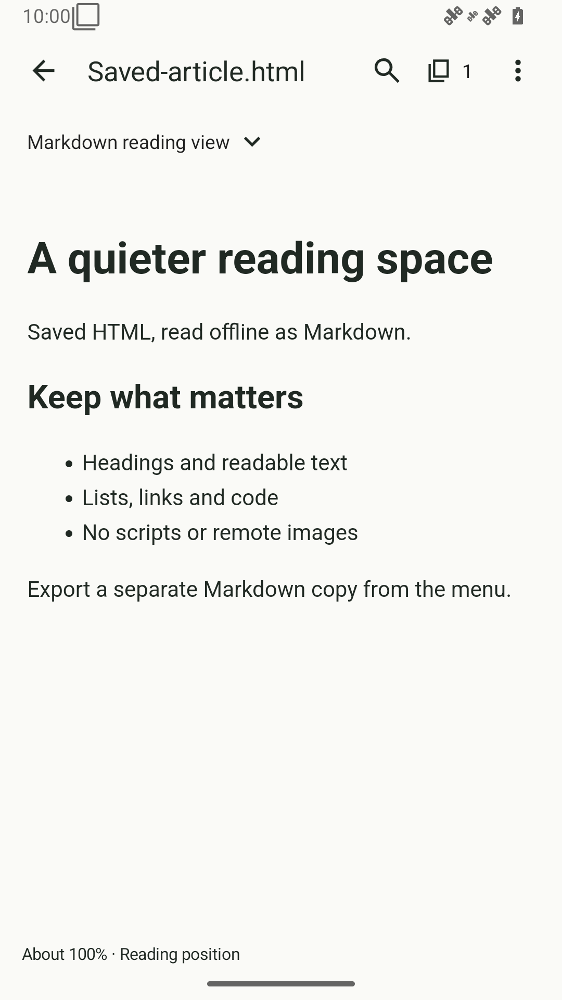
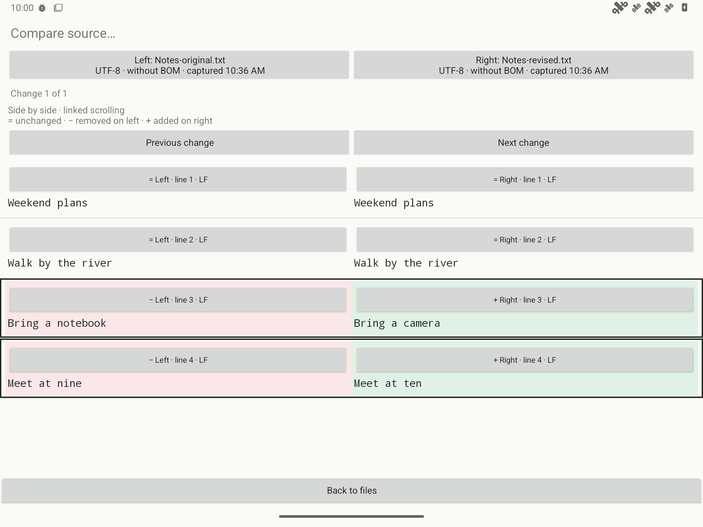

# Textr

Textr is an offline text reader and inspector for Android, with explicit editing of separate TXT/Markdown copies. Open files from other apps or the system file picker, revisit recent files, and switch between plain text, syntax highlighting, and supported formatted previews.

**Android 10+ · Offline · English and German · GPL-3.0-only**

**Current testing release:** [0.3-alpha](https://github.com/utrost/Textr/releases) (version code 3), a private draft prerelease for repository maintainers. It adds reading-position preservation and actionable file/save recovery to the 0.2-alpha features. It updates either previous alpha in place with the same development signing identity. See [release notes](docs/release-notes-0.3-alpha.md).

**Integration status:** the implementation is merged into `main` through [PR #96](https://github.com/utrost/Textr/pull/96). All five 0.2-alpha feature epics and 19 implementation issues are complete. The [next roadmap](docs/roadmap.md#next-roadmap--reliable-daily-use) plans six epics and 13 new implementation issues around reliability, copy editing, comparison, reading organization, formats and release preparation. The implementation passed build/lint, 86 JVM tests and 123 device tests per API 29/36. The subsequent [main run](https://github.com/utrost/Textr/actions/runs/44716759569) passed build/unit/lint and API 36, but API 29 passed 122/123 with a foldable-position failure tracked in [#97](https://github.com/utrost/Textr/issues/97). [Validation](docs/validation-roadmap-implementation.md) retains exact-source evidence. Physical-device/human TalkBack review and [WebView accessibility #59](https://github.com/utrost/Textr/issues/59) remain open.

The source is public. Public APK distribution, production signing and store publication remain deferred. Draft release assets require repository write access; everyone can [build locally](#build-and-install).

| Markdown preview | JavaScript source | Optional wide-screen sidebar |
| --- | --- | --- |
|  |  |  |

| HTML as Markdown | JSON structure | Edit a Markdown copy |
| --- | --- | --- |
|  |  |  |



The reliability follow-up implements clearer [opening/save recovery](docs/recovery.md) and preserves pending reading position during recreation. It is merged through [PR #117](https://github.com/utrost/Textr/pull/117) and included in 0.3-alpha. Build/lint, 86 JVM tests and 129 device tests per API 29/36 pass; see [evidence and remaining acceptance](docs/validation-reliability.md).

[More screenshots and capture details](docs/screenshots.md) · [Feature roadmap](docs/roadmap.md)


## What it does

- Opens text files up to **5 MiB** through Android’s file picker, **Open with**, or **Share**.
- Reads TXT, LOG, CONF/CFG, INI, JSON, Markdown, YAML, TOML, XML, CSV/TSV, .env, .properties, Dockerfile, Java, JavaScript, TypeScript/TSX, CSS, HTML, Kotlin, Python, shell, SQL, diff/patch, and iCalendar. Other text files can be opened through the picker.
- Offers plain text, lightweight syntax highlighting, and supported Markdown, JSON, calendar and optional CSV previews. Plain text remains the baseline.
- Searches the displayed view or the complete source, with case/whole-word matching, line numbers and snippets. Includes Go to line, a Markdown heading outline, and bounded JSON/XML [structure navigation](docs/structured-navigation.md).
- Supports selection/copy, original-file sharing, read-only **Open with…**, [global/per-document reading settings](docs/reading-preferences.md) for size, wrapping, fonts and spacing, and system/light/dark themes.
- Compares bounded source snapshots with exact line-ending-aware changes, keyboard/copy actions and linked side-by-side views; compact/large-text windows use unified comparison.
- Offers **Edit a copy…** for TXT/Markdown, with bounded undo/redo, literal find/replace, private recovery and explicit Save as. See [editor limits and fidelity](docs/editing-copies.md).
- Exports converted HTML reading content to a new UTF-8 Markdown file through [Save Markdown as](docs/save-as.md).
- Remembers recent files and approximate reading positions. Pin recents, keep up to five documents open, and save up to 100 named bookmarks.
- Offers an optional file sidebar on sufficiently large windows, plus keyboard shortcuts. The sidebar stays off until you enable it.
- Provides English and German controls, errors, preview labels and offline help, following the device/app language. Document contents are never translated.
- Shows reading, preparation and layout stages, with cancellation and explanations when loading takes longer.

Opening a format does not guarantee highlighting. Generic configuration files use plain text unless their syntax is recognized. HTML opens as source and offers an optional offline [Markdown reading view](docs/html-reading.md) for saved/shared HTML. CSV starts as text; table preview requires explicit delimiter/header choices. See [formats and limits](docs/formats.md) and [everyday format rules](docs/everyday-formats.md).

## Open a file

Use **Open file** on the home screen, or choose Textr from another app’s **Open with** or **Share** action. Tap the display-mode button to change views; **⋮** contains file actions, reading settings, bookmarks and About.

**Android controls default-app associations.** Where Android offers **Always**, you can choose Textr. The available choices depend on the sending app and reported MIME type, not just the filename extension. Textr cannot force an association for every extension. The system file picker remains a fallback.

The empty home screen links to opening help. On eligible windows, a dismissible hint points to **Reading settings → File sidebar on wide screens**. Both hints stay dismissed; help and settings remain available from the menu.

[Installation and opening guide](docs/installing.md) · [Search and encodings](docs/everyday-reading.md) · [Documents and history](docs/open-documents.md) · [CSV, bookmarks and shortcuts](docs/reading-extras.md) · [Foldables](docs/foldable-layout.md)

## Privacy

No accounts, ads, analytics, or app network permission. Original files remain unchanged. Documents are processed locally. External document providers may independently use the network, and links open externally only when tapped.

History, sessions and bookmarks store local references and reading metadata, not document contents. Explicit sharing creates temporary copies, bounded to 20 and cleaned after 24 hours on the next app start/share. These copies are separate from history. Explicit copy editing retains one private content-bearing recovery checkpoint until discarded or its matching revision is saved. App backup and device-transfer rules exclude private state. JavaScript, remote resources and WebView file/content access are disabled.

Read the [privacy policy](docs/privacy.md), also linked from **About Textr**. Moving a file or losing its provider permission can make a stored reference unavailable; choose the file again. Clearing history or bookmarks never deletes the original files.

## Build and install

Requirements: **JDK 17**, Android SDK **Platform 36** and **Build Tools 36.0.0**. Set `ANDROID_HOME`, or put `sdk.dir` in an untracked `local.properties`. Android Studio can import the project. The included Gradle wrapper downloads dependencies on the first build.

```sh
./gradlew :app:assembleDebug
./gradlew :app:testDebugUnitTest :app:lintDebug
```

The APK is `app/build/outputs/apk/debug/app-debug.apk`. With an emulator or device connected:

```sh
adb install -r app/build/outputs/apk/debug/app-debug.apk
./gradlew :app:connectedDebugAndroidTest
```

Use `gradlew.bat` on Windows. Debug builds use a development signing key and are not public release artifacts. CI builds debug APKs and runs tests on Android 10/API 29 and Android 16/API 36. See [development](docs/development.md), [validation](docs/validation.md), and [release signing](docs/releasing.md).

## Limits and release readiness

- Automatic decoding supports UTF-8 and BOM-marked UTF-16. Explicit encoding choices also support Windows-1252, ISO-8859-1 and UTF-16 without a BOM.
- Previews and highlighting have [bounded complexity and size](docs/formats.md); larger or invalid previews fall back to source. Large text files and long lines may display slowly.
- Markdown images, raw embedded HTML and relative file links are unsupported. Local HTML conversion is available in 0.2-alpha; it never loads the original page or remote resources. Calendar recurrence is not expanded; no events or alarms are imported.
- Search is literal, within one file; source results are capped at 200. Copy editing accepts at most 256 Ki characters, 10,000 lines and 4,096 characters per line; comparison has separate [input/work limits](docs/comparison.md). No in-place editing, file management, unbounded tabs, or huge-log support.
- WebView 133 can omit CSV cells and source nodes. **⋮ → Accessible table… → Show source** provides a native compatibility route for bounded CSV documents. See [behavior and validation](docs/validation-reader-polish.md). Human spoken-feedback and physical foldable checks remain follow-ups.
- Public APK release, real-device beta and optional Play distribution have separate remaining gates in the [roadmap](docs/roadmap.md).

## Contribute and get help

[Report a reproducible problem or suggest a feature](https://github.com/utrost/Textr/issues). Include Android/WebView versions and a small synthetic sample when relevant; avoid private documents and credentials. Read [CONTRIBUTING.md](CONTRIBUTING.md) and [SECURITY.md](SECURITY.md).

Textr uses Kotlin, native Android controls, AndroidX Activity and an offline WebView. CommonMark handles Markdown; Jackson Core formats JSON while preserving numeric spelling and duplicate keys. The [scope](docs/scope.md) records product boundaries.

## License

GNU General Public License, version 3 only (`GPL-3.0-only`). See [LICENSE](LICENSE). Dependency notices are bundled in [Attributions.txt](app/src/main/assets/licenses/Attributions.txt) and **About Textr → Open-source licenses**.
