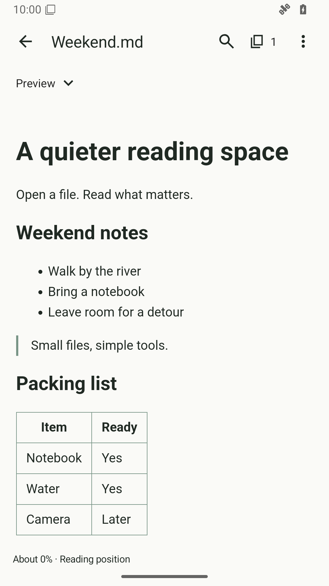
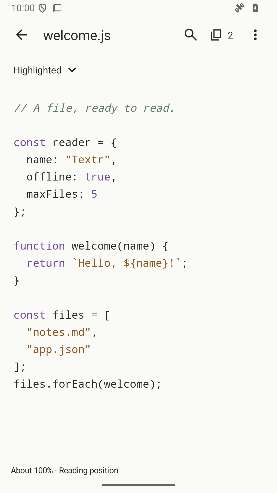
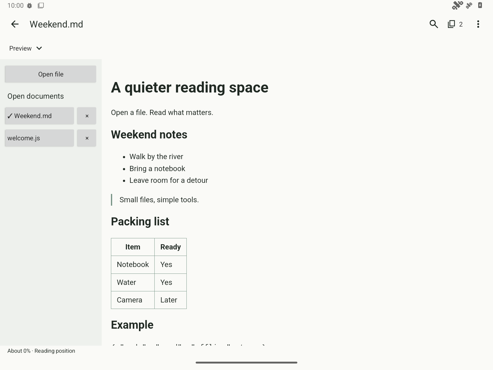
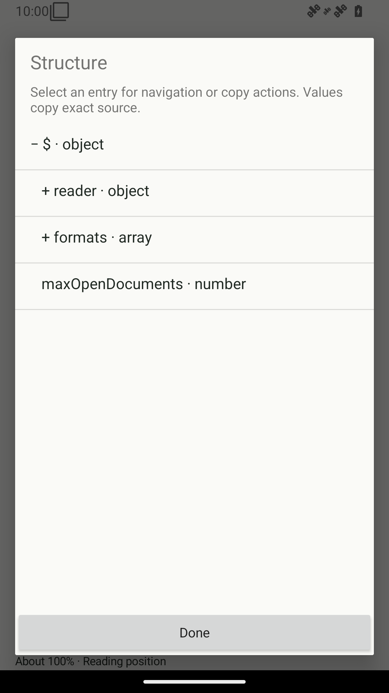
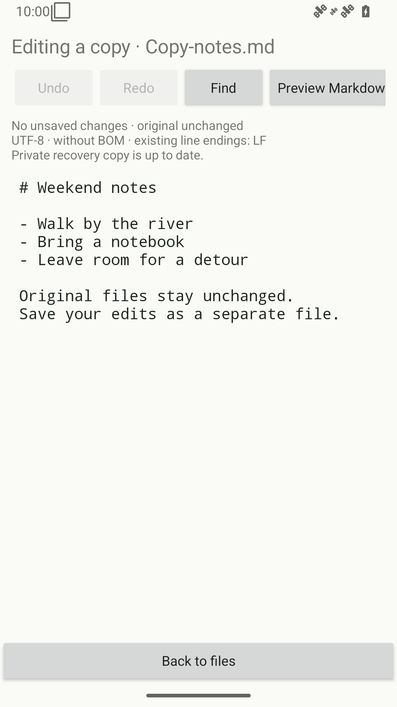
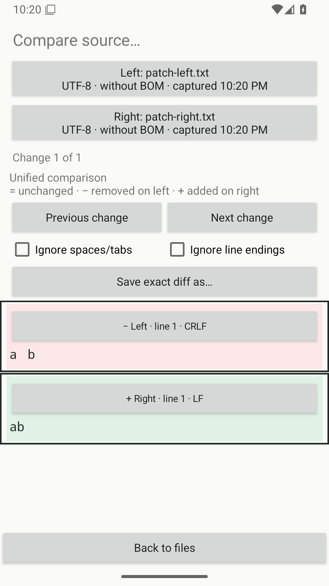
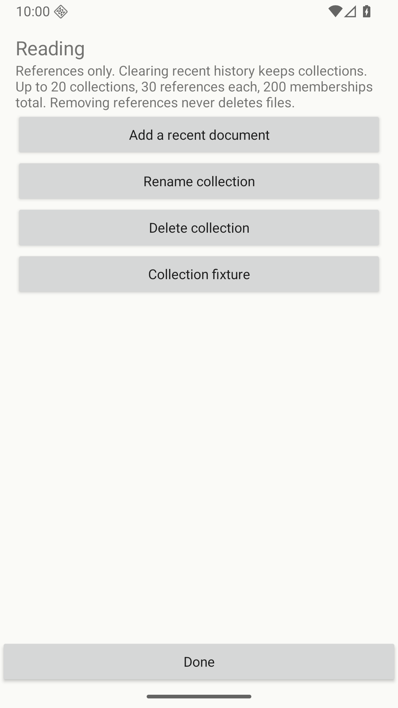
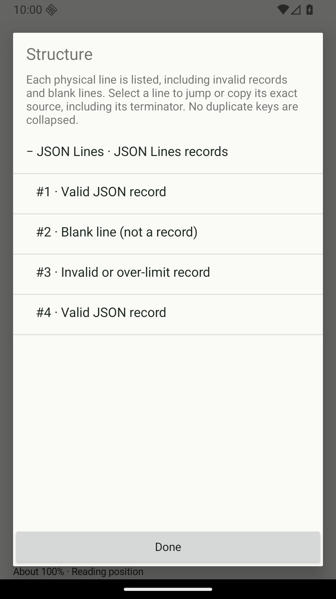
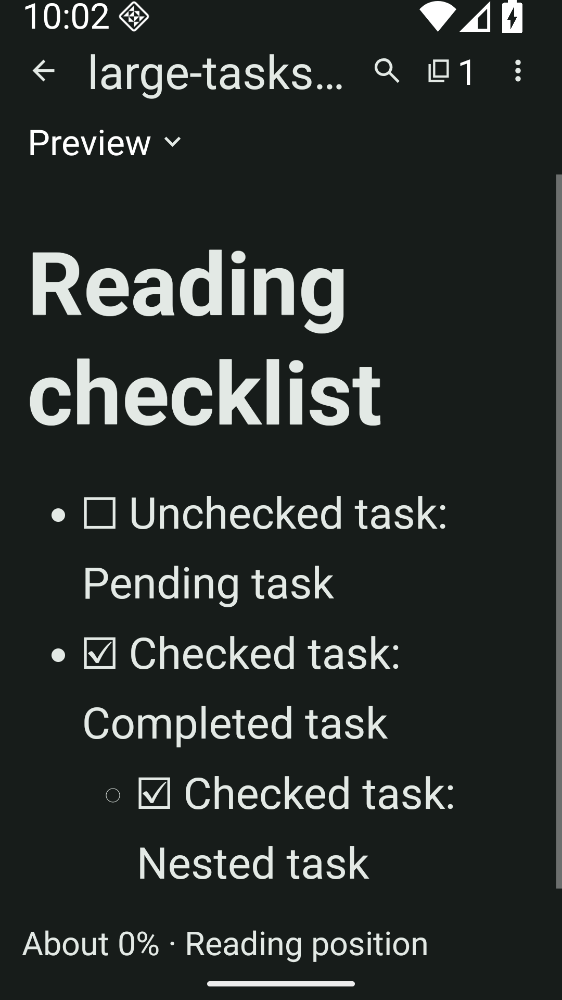

# Textr

Textr is an offline text reader and inspector for Android, with explicit editing of separate TXT/Markdown copies. Open files from other apps or the system file picker, revisit recent files, and switch between plain text, syntax highlighting, and supported formatted previews.

**Android 10+ · Offline · English and German · GPL-3.0-only**

[](https://github.com/utrost/Textr/actions/workflows/ci.yml)

**Latest private testing release: [0.5-alpha · version code 5](https://github.com/utrost/Textr/releases/tag/untagged-403cd7772a9feb20b00d).** Repository maintainers can download the APK, matching source, checksums and signing records from the draft. It includes all ten roadmap additions and the earlier eight quality-of-life improvements. Read the [release notes](docs/release-notes-0.5-alpha.md) and [installation/upgrade guide](docs/installing.md). Public source is available to everyone; [build locally](#build-and-install) for a development APK.

**Project status:** the feature roadmap is implemented and merged through [PR #127](https://github.com/utrost/Textr/pull/127). The accepted 0.5-alpha implementation passed **102 JVM tests, lint and 164 device tests on each of API 29 and 36**, plus fresh-install, 0.4-alpha upgrade and unsigned F-Droid build/scanning checks. See the [validation record](docs/validation-roadmap-completion.md) and [current CI](https://github.com/utrost/Textr/actions/workflows/ci.yml).

The remaining [roadmap work](docs/roadmap.md) is physical-provider, spoken TalkBack and foldable acceptance ([#56](https://github.com/utrost/Textr/issues/56)), the [WebView accessibility investigation (#59)](https://github.com/utrost/Textr/issues/59), and distribution gates. Standard F-Droid signing is selected and prepared; external submission, public APK publication, production signing and Play publication remain deferred. Developer/privacy/support contact: **utrost**, through [Textr issues](https://github.com/utrost/Textr/issues).

| Markdown preview | JavaScript source | Optional wide-screen sidebar |
| --- | --- | --- |
|  |  |  |

| HTML as Markdown | JSON structure | Edit a Markdown copy |
| --- | --- | --- |
|  |  |  |



| Collections | JSONL records | Read-only tasks at 200% text |
| --- | --- | --- |
|  |  |  |

[More screenshots and capture details](docs/screenshots.md) · [Feature roadmap](docs/roadmap.md)


## What it does

- Opens text files up to **5 MiB** through Android’s file picker, **Open with**, or **Share**.
- Reads TXT, LOG, CONF/CFG, INI, JSON, JSONL/NDJSON, AsciiDoc, reStructuredText, Markdown, YAML, TOML, XML, CSV/TSV, .env, .properties, Dockerfile, Java, JavaScript, TypeScript/TSX, CSS, HTML, Kotlin, Python, shell, SQL, diff/patch, and iCalendar. Other text files can be opened through the picker.
- Offers plain text, lightweight syntax highlighting, and supported Markdown, JSON, calendar and optional CSV previews. Plain text remains the baseline.
- Searches the displayed view or the complete source, with case/whole-word matching, line numbers and snippets. Includes Go to line, a Markdown heading outline, and bounded JSON/XML and per-record JSONL [structure navigation](docs/structured-navigation.md).
- Offers **Copy all** in the reader menu for the complete source text, including original line breaks and excluding displayed line numbers. Up to 256 Ki UTF-16 characters can be copied at once; larger documents show an explanation without truncating or replacing the clipboard. Preview modes also copy source text.
- Supports selection/copy, original-file sharing, read-only **Open with…**, [global/per-document reading settings](docs/reading-preferences.md) for size, wrapping, fonts and spacing, and system/light/dark themes.
- Compares bounded source snapshots with exact changes, optional whitespace/ending display filters, exact unified patch export, keyboard/copy actions and linked side-by-side views; compact/large-text windows use unified comparison.
- Offers **Edit a copy…** for TXT/Markdown, with bounded undo/redo, literal find/replace, line/indentation actions, original/draft review, private recovery and explicit Save as with Open saved copy. See [editor limits and fidelity](docs/editing-copies.md).
- Exports converted HTML reading content to a new UTF-8 Markdown file through [Save Markdown as](docs/save-as.md).
- Remembers recent files and approximate reading positions. Pin recents, keep up to five documents open, save up to 100 named bookmarks, and organize references in bounded [reading collections](docs/collections.md).
- Offers an optional file sidebar on sufficiently large windows, plus keyboard shortcuts. The sidebar stays off until you enable it.
- Provides English and German controls, errors, preview labels and offline help, following the device/app language. Document contents are never translated.
- Shows reading, preparation and layout stages, with cancellation and explanations when loading takes longer.

Opening a format does not guarantee highlighting. Generic configuration files use plain text unless their syntax is recognized. HTML opens as source and offers an optional offline [Markdown reading view](docs/html-reading.md) for saved/shared HTML. CSV starts as text; table preview requires explicit delimiter/header choices. See [formats and limits](docs/formats.md) and [everyday format rules](docs/everyday-formats.md).

## Quality-of-life additions

The merged quality-of-life batch adds recent-file search/filtering, previous reading positions, Copy Markdown for HTML, unsaved Markdown preview, reopening closed documents, optional screen-awake reading, Find selected text and a last-save-location suggestion. See the [usage guide](docs/quality-of-life.md) and [validation](docs/validation-quality-of-life.md). All eight improvements are included in 0.5-alpha alongside the editor, comparison, collections and format additions shown above.

## Open a file

Use **Open file** on the home screen, or choose Textr from another app’s **Open with** or **Share** action. Tap the display-mode button to change views; **⋮** contains file actions, reading settings, bookmarks and About.

**Android controls default-app associations.** Where Android offers **Always**, you can choose Textr. The available choices depend on the sending app and reported MIME type, not just the filename extension. Textr cannot force an association for every extension. The system file picker remains a fallback.

The empty home screen links to opening help. On eligible windows, a dismissible hint points to **Reading settings → File sidebar on wide screens**. Both hints stay dismissed; help and settings remain available from the menu.

[Installation and opening guide](docs/installing.md) · [Search and encodings](docs/everyday-reading.md) · [Documents and history](docs/open-documents.md) · [CSV, bookmarks and shortcuts](docs/reading-extras.md) · [Foldables](docs/foldable-layout.md)

## Privacy

No accounts, ads, analytics, or app network permission. Original files remain unchanged. Documents are processed locally. External document providers may independently use the network, and links open externally only when tapped.

History, sessions, collections and bookmarks store local references and reading metadata, not document contents. Explicit sharing creates temporary copies, bounded to 20 and cleaned after 24 hours on the next app start/share. These copies are separate from history. Explicit copy editing retains one private content-bearing recovery checkpoint (current draft and initial original snapshot) until discarded or its matching revision is saved. App backup and device-transfer rules exclude private state. JavaScript, remote resources and WebView file/content access are disabled.

Read the [privacy policy](docs/privacy.md), also linked from **About Textr**. Moving a file or losing its provider permission can make a stored reference unavailable; choose the file again. Clearing history or bookmarks never deletes the original files.

## Build and install

Requirements: **JDK 17**, Android SDK **Platform 36** and **Build Tools 36.0.0**. Set `ANDROID_HOME`, or put `sdk.dir` in an untracked `local.properties`. Android Studio can import the project. Current main uses **Gradle 9.9.0 / Android Gradle Plugin 9.5.1**; the included wrapper verifies the distribution checksum and downloads dependencies on the first build. The immutable 0.5-alpha source tag retains its original toolchain.

```sh
./gradlew :app:assembleDebug
./gradlew :app:testDebugUnitTest :app:lintDebug
```

The APK is `app/build/outputs/apk/debug/app-debug.apk`. With an emulator or device connected:

```sh
adb install -r app/build/outputs/apk/debug/app-debug.apk
./gradlew :app:connectedDebugAndroidTest
```

Use `gradlew.bat` on Windows. Debug builds use a development signing key and are not public release artifacts. CI builds debug APKs and runs tests on Android 10/API 29 and Android 16/API 36. See [development](docs/development.md), [validation](docs/validation.md), and [release signing](docs/releasing.md).

## Limits and release readiness

- Automatic decoding supports UTF-8 and BOM-marked UTF-16. Explicit encoding choices also support Windows-1252, ISO-8859-1 and UTF-16 without a BOM.
- Previews and highlighting have [bounded complexity and size](docs/formats.md); larger or invalid previews fall back to source. Large text files and long lines may display slowly.
- Markdown images, raw embedded HTML and relative file links are unsupported. Local HTML conversion never loads the original page or remote resources. Calendar recurrence is not expanded; no events or alarms are imported.
- Search is literal, within one file; source results are capped at 200. Copy editing accepts at most 256 Ki characters, 10,000 lines and 4,096 characters per line; comparison has separate [input/work limits](docs/comparison.md). No in-place editing, file management, unbounded tabs, or huge-log support.
- WebView 133 can omit CSV cells and source nodes. **⋮ → Accessible table… → Show source** provides a native compatibility route for bounded CSV documents. See [behavior and validation](docs/validation-reader-polish.md). Human spoken-feedback and physical foldable checks remain follow-ups.
- Public APK release, real-device beta and optional Play distribution have separate remaining gates in the [roadmap](docs/roadmap.md).

## Contribute and get help

[Report a reproducible problem or suggest a feature](https://github.com/utrost/Textr/issues). Include Android/WebView versions and a small synthetic sample when relevant; avoid private documents and credentials. Read [CONTRIBUTING.md](CONTRIBUTING.md) and [SECURITY.md](SECURITY.md).

Textr uses Kotlin, native Android controls, AndroidX Activity and an offline WebView. CommonMark handles Markdown; Jackson Core formats JSON while preserving numeric spelling and duplicate keys. The [scope](docs/scope.md) records product boundaries.

## License

GNU General Public License, version 3 only (`GPL-3.0-only`). See [LICENSE](LICENSE). Dependency notices are bundled in [Attributions.txt](app/src/main/assets/licenses/Attributions.txt) and **About Textr → Open-source licenses**.
