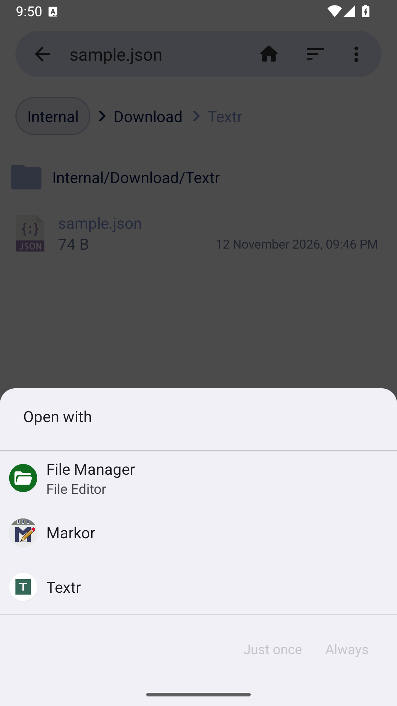
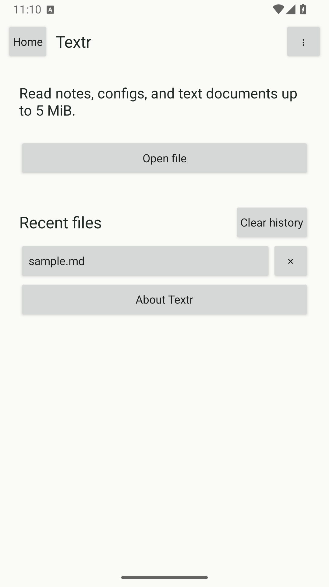
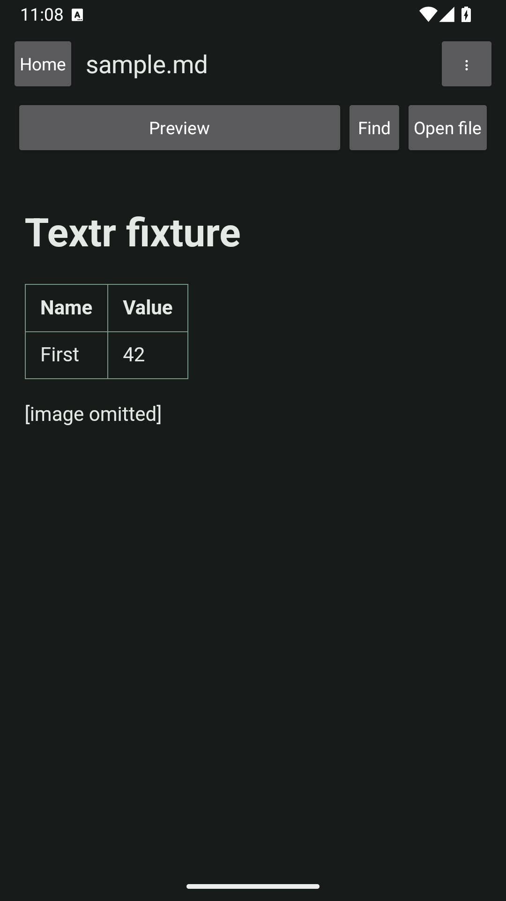
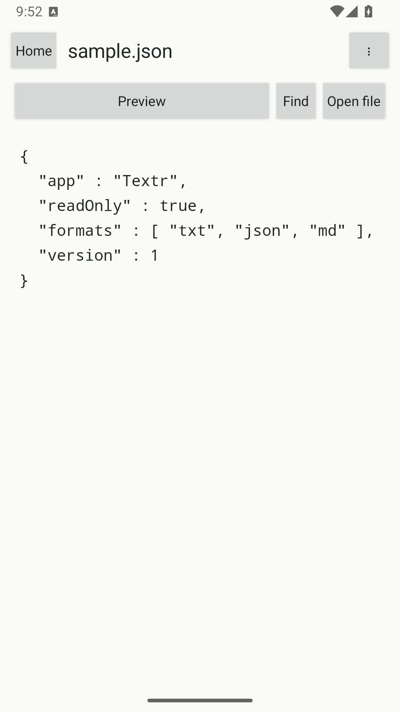

# Installing and opening files

Textr supports Android 10 (API 29) and newer. Public release is deferred; no public APK is currently available. Use the [development build instructions](development.md) to build and install the candidate. CI debug artifacts are development builds. Future authorized releases will appear under [GitHub Releases](https://github.com/utrost/Textr/releases).

## Install a future release APK

1. Download the APK and checksum from the same release. Use the release's source tag and signing-certificate fingerprint to identify that version.
2. On a computer, compare `sha256sum Textr-VERSION.apk` with the published checksum. On Windows, use `Get-FileHash Textr-VERSION.apk -Algorithm SHA256` in PowerShell.
3. Open the APK on Android. If prompted, allow **Install unknown apps** for the browser or file manager you used, then install Textr. You can turn that permission off afterward. Android's exact wording varies by device.
4. Open Textr and tap **Open file**. Pick a text document using the system file picker.

A later APK with the same application ID and signing key installs as an update and preserves Textr's settings and recent references. A local debug build usually has a different key; Android will reject that update. Removing a debug installation first removes its private settings/history, while the original documents remain in their provider.

## Choose Textr as a default

In a file manager, tap a text file or choose **Open with**. If Android offers a chooser, select **Textr**, then **Always**. **Just once** leaves the current default unchanged. Some apps supply their own chooser or preview and never offer **Always**.

Default choices depend on the incoming intent and MIME type, not simply the extension. A default for `application/json` does not necessarily set the default for TXT, Markdown, or a generic configuration file. To change an existing default, open Android **Settings → Apps → the current app → Open by default** and clear its defaults where available; labels vary by Android version and vendor.

If Textr is absent, open Textr directly and use **Open file**, or try the sender's **Share** action. Textr accepts text, supported application MIME types, and generic binary MIME requests, then validates the actual bytes. Binary files are rejected with a readable message. A sender that omits or mislabels its file type can still prevent an Android chooser association; no app can promise universal extension defaults.

## Read and revisit

| Home in the light theme | Markdown in the dark theme |
| --- | --- |
|  |  |

- Tap the current display-mode button to switch between plain text, highlighted source, and available preview modes. CSV and unrecognized configurations stay plain text.
- **Find** searches the displayed view. Use the arrows to move through matches and **×** to close search. Source and preview searches may differ.
- Long-press text to select it, then choose Android's **Copy** action.
- Open **⋮ Reading settings** for text size, line wrapping, and system/light/dark appearance.
- **Home** shows the last 30 successfully opened file references. **×** removes one entry; **Clear history** removes all entries. These actions never delete the files.

Recent files reopen only while their providers still grant access. Picker-selected files usually offer persistent read access; shared attachments may offer temporary access only. If a document moved, was deleted, or lost access, use **Open file again** to select it or a replacement. Shared text without a file URI is available for that session and rotation, but cannot be reopened after process termination.

## Limits and troubleshooting

The source limit is 5 MiB. UTF-8 and BOM-marked UTF-16 are supported. Oversized, binary, unsupported-encoding, and unavailable files show explanations and an action to choose another file. Complex or invalid previews fall back to readable source. If Android terminates a WebView renderer, Textr offers **Retry as plain text** and **Open file**.

Textr has no network permission. A selected external document provider can fetch its own content, and tapping a web/email link launches another app. Images, embedded HTML, scripts, and automatic remote resources are not rendered.
