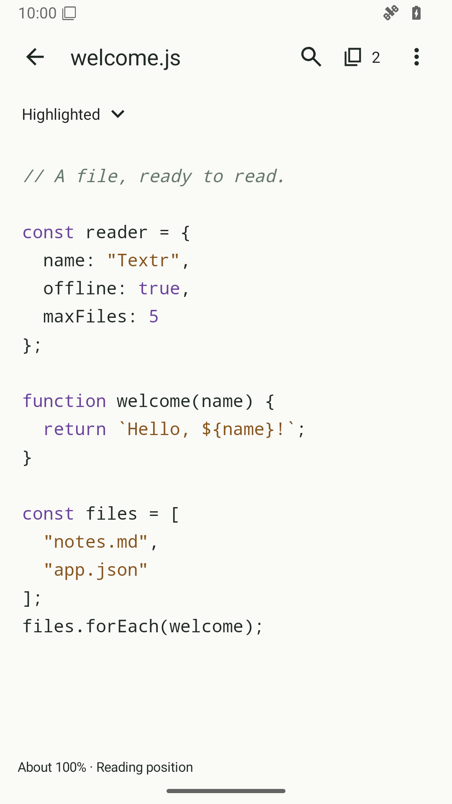
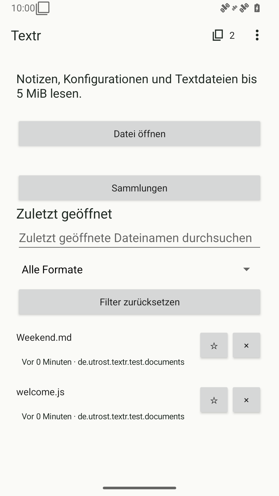
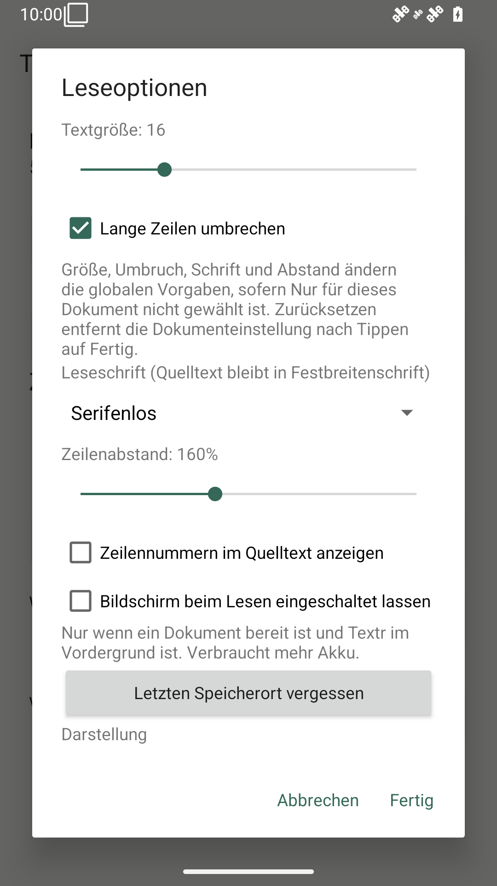
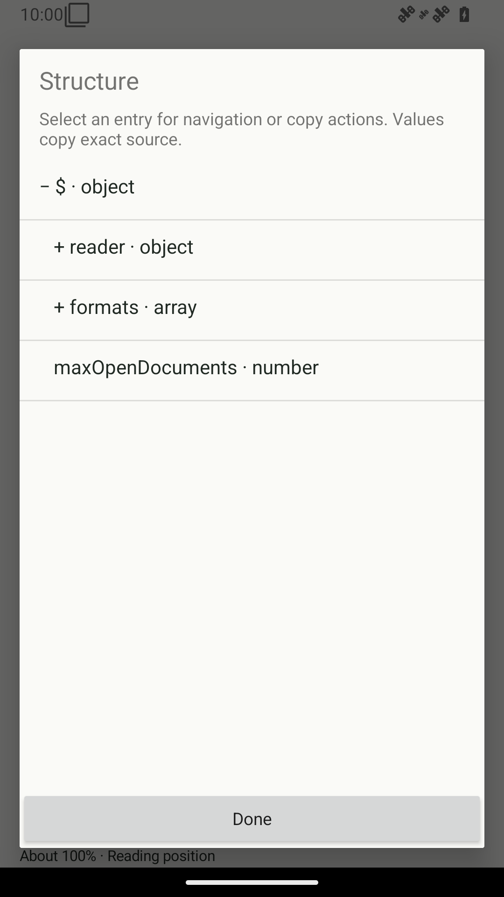
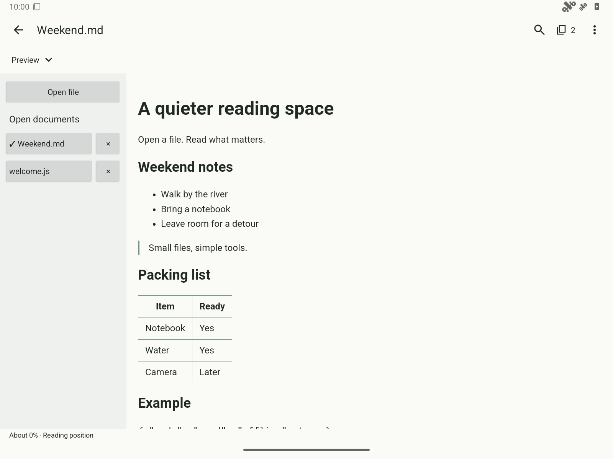

# Screenshots

Refreshed 21 November 2026 from the 0.5-alpha app source (`a410407`, application tree unchanged from `d9a3e42`), using its debug build and test fixture provider. Captured on an Android 16/API 36 emulator with WebView 133.0.6943.137, using synthetic documents only. Phone captures use 1080×1920 at 420 dpi; the wide capture uses 1600×1200 at 240 dpi. System font scale is 1.0. These are emulator screenshots, not photographs or physical Magic V6 validation. Pixels are not retouched; Android’s demo clock is used where supported.

| Home | Markdown | Source |
| --- | --- | --- |
|  |  |  |

| German home | German settings | Dark theme |
| --- | --- | --- |
|  |  |  |

| HTML reading view | JSON structure | Copy editor |
| --- | --- | --- |
|  |  |  |


The HTML view shows the conversion, not a fetched website. The editor shows an explicit separate copy with original-preservation and recovery controls. Comparison captures two read-only snapshots; it does not merge or write files.



## Reproduce

Build and install both debug and androidTest APKs on a **disposable API 33+ emulator**. The test APK supplies synthetic documents and is never included in the production app. Set `ANDROID_HOME`, then run:

```sh
./gradlew :app:assembleDebug :app:assembleDebugAndroidTest
adb -s EMULATOR_SERIAL install -r app/build/outputs/apk/debug/app-debug.apk
adb -s EMULATOR_SERIAL install -r app/build/outputs/apk/androidTest/debug/app-debug-androidTest.apk
python3 scripts/capture-screenshots.py --serial EMULATOR_SERIAL --reset-app-data
```

The explicit flag acknowledges that the script clears **Textr’s emulator app data**, sets demo display/language/theme state and installs synthetic reading preferences. It requires no release signing key and publishes nothing. Do not run it on a personal device or concurrently with instrumentation. The script restores default display size/density, app-language selection and font scale, but leaves development preferences and animations configured for capture; use a disposable emulator.

The older images elsewhere in this directory remain historical documentation of earlier iterations. The `reading-*` images above are the current 0.5-alpha documentation set, including HTML reading, JSON navigation, copy editing and wide comparison. [Store artwork](store/) derives from the existing vector launcher icon and includes editable SVG sources.

## Roadmap completion captures

Captured 21 November 2026 from the 0.5-alpha implementation branch on the disposable API 36 emulator (1080×1920, synthetic fixtures). The collection and JSONL captures use normal system text; the task-list capture uses dark theme and **200% system text**. These PNGs are direct device screenshots without retouching. They demonstrate native collection controls, explicit invalid/blank JSONL records and visible read-only checked/unchecked labels; they do not establish human TalkBack or physical-provider acceptance.

| Reference collections | JSONL navigation | Tasks at 200% text |
| --- | --- | --- |
|  |  |  |

Reproduce with `RoadmapCompletionDeviceTest` on a disposable emulator. It writes `roadmap-*.png` to the target app cache using UiDevice screenshots; extract with `adb exec-out run-as de.utrost.textr cat cache/NAME.png > NAME.png`. Do not run concurrently with other instrumentation. The comparison image above shows the current side-by-side mode; unified filter/export controls are shown below.


The comparison capture waits for the bottom action to be fully visible within the window frame before saving the screenshot; the same check passes in instrumentation. Filenames and sample text are synthetic.
