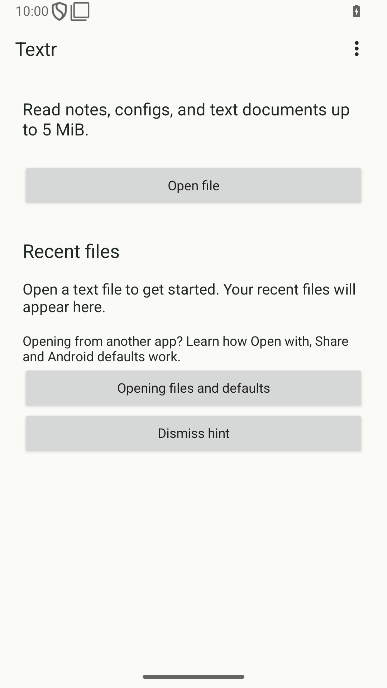
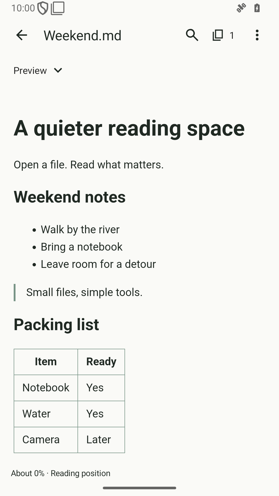
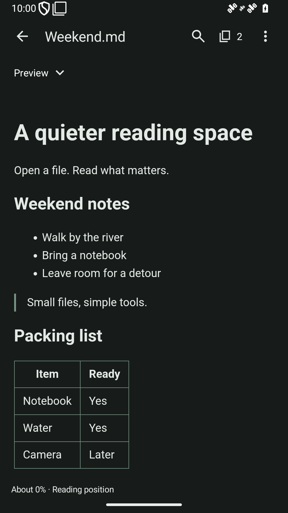

# Screenshots

Captured from the development app on an Android 16/API 36 emulator with WebView 133.0.6943.137, using synthetic documents only. Phone captures use 1080×1920 at 420 dpi; the wide capture uses 1600×1200 at 240 dpi. System font scale is 1.0. These are emulator screenshots, not photographs or physical Magic V6 validation. Pixels are not retouched; Android’s demo clock is used where supported.

| Home | Markdown | Source |
| --- | --- | --- |
|  |  |  |

| German home | German settings | Dark theme |
| --- | --- | --- |
|  |  |  |


## Reproduce

Build and install both debug and androidTest APKs on a **disposable API 33+ emulator**. The test APK supplies synthetic documents and is never included in the production app. Set `ANDROID_HOME`, then run:

```sh
./gradlew :app:assembleDebug :app:assembleDebugAndroidTest
adb -s EMULATOR_SERIAL install -r app/build/outputs/apk/debug/app-debug.apk
adb -s EMULATOR_SERIAL install -r app/build/outputs/apk/androidTest/debug/app-debug-androidTest.apk
python3 scripts/capture-screenshots.py --serial EMULATOR_SERIAL --reset-app-data
```

The explicit flag acknowledges that the script clears **Textr’s emulator app data**, sets demo display/language/theme state and installs synthetic reading preferences. It requires no release signing key and publishes nothing. Do not run it on a personal device or concurrently with instrumentation. The script restores default display size/density, app-language selection and font scale, but leaves development preferences and animations configured for capture; use a disposable emulator.

The older images elsewhere in this directory remain historical documentation of earlier iterations. The `reading-*` images above are the current public-readiness set. [Store artwork](store/) derives from the existing vector launcher icon and includes editable SVG sources.
